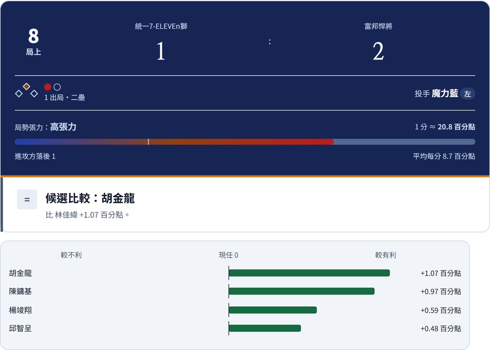
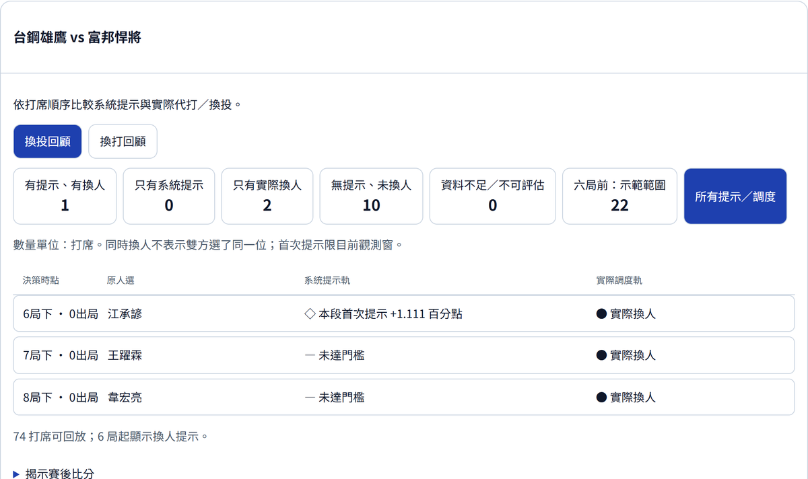

# 一球兩面｜臨場用人決策

> 比賽打到關鍵打席，該讓現任打者續打、派代打，還是換投？
> 這個網站用中職公開資料，在**同一個局勢**下比較每位候選人選，回答教練最需要的三個問題：**差多少？誰接守？憑什麼？**

**👉 線上網站：https://da-xiong-chen.github.io/baseball_project/**（免安裝，電腦與手機都能用）

| 項目 | 內容 |
|---|---|
| 競賽 | 2026 野革盃 台灣棒球數據黑客松 |
| 隊名／成員 | 一球兩面｜蘇櫟、陳信安 |
| 參賽簡報 | [32 頁提案（PPT／PDF）與 36 秒操作影片](presentations/competition-2026/README.md) |
| 資料 | 2024–2025 中職一軍例行賽逐球紀錄（Rebas Open Data）與歷年守位 |



## 目錄

- [評審快速導覽](#評審快速導覽)
- [解決什麼問題](#解決什麼問題)
- [主要功能](#主要功能)
- [一個實際例子](#一個實際例子)
- [方法](#方法)
- [驗證結果](#驗證結果)
- [限制](#限制)
- [本機執行](#本機執行)
- [專案結構與文件](#專案結構與文件)
- [資料來源與授權](#資料來源與授權)
- [研究依據](#研究依據)

## 評審快速導覽

只有幾分鐘的話，建議依這個順序看：

| 想確認的事 | 去哪裡看 |
|---|---|
| 作品實際能做什麼 | 打開[線上網站](https://da-xiong-chen.github.io/baseball_project/)，選「一般使用者」→「代打評估」→ 按「評估」 |
| 系統的建議和教練實際調度差在哪 | 網站上方選「單日分析」，看 2025/09/20 三場比賽逐打席的系統提示與實際調度 |
| 方法和數據 | 本頁[方法](#方法)與[驗證結果](#驗證結果)；完整說明見 [docs/技術細節.md](docs/技術細節.md) |
| 驗證是否確實 | [最新驗收紀錄](docs/qa/competition-ready-20261023/README.md)、[全部測試與驗收索引](docs/qa/README.md) |
| 提案內容 | [32 頁參賽簡報](presentations/competition-2026/README.md) |

**我們的四個重點：**

1. **比較基準一致**：所有候選都和「現任」比，現任固定為 0，正值就是估計較有利。不同人選之間的差距可以直接讀。
2. **不只比打擊，也檢查守備**：代打之後誰接守、守位排不排得出來、會不會多用掉一位板凳，都和打擊估計一起列出。
3. **小樣本不誇大**：替補和後援的對戰樣本很少，用部分池化把小樣本向整體基準收縮，避免幾個打席就下結論。
4. **歷史回放只用賽前資料**：回到 2025 年的比賽時，能力、名單、負荷都只用比賽當天以前的資料，不偷看結果。

## 解決什麼問題

換人是教練在比賽中最常做、也最難事後評估的決定。數據網站多半只列出球員整季成績，但臨場需要的是另一種資訊：

- **差多少**：在「這個投手、這個局數、這個比分與壘況」下，換上誰比現任更有利？差距有多大？
- **誰接守**：代打之後守備排得出來嗎？需不需要再動用一位板凳？
- **憑什麼**：估計的依據是什麼？樣本夠不夠？兩個模型的看法一致嗎？

本作品的範圍是**打席與打席之間的換人決定**（代打、換投），不處理打席中的逐球策略。

## 主要功能

| 功能 | 說明 |
|---|---|
| **代打評估** | 設定局數、比分、壘況、出局、對方投手與輪到的打者，比較現任與最多四位板凳候選的勝率換算差距，並檢查換人後的接守安排 |
| **換投評估** | 輸入場上投手的本場球數，比較牛棚投手對上接下來三棒的差距，並納入用球數造成的疲勞 |
| **我方場上名單** | 用球場圖和棒次表安排九棒與投手，可用姓名或 2025 背號搜尋；球隊模式下，候選會自動排除場上球員 |
| **2025 單日分析** | 回到 2025/09/20 的三場比賽（共 226 個打席），只用賽前資料看系統當時的建議，再依序揭示教練的實際調度與結果 |

網站上方有三個入口：

- **一般使用者**：直接挑人比較，適合球迷或分析者。
- **球隊**：先套用我方場上名單，候選只從板凳與牛棚中選，適合模擬實際用兵。
- **單日分析**：回顧 2025 年的真實比賽，對照系統提示與實際調度。



## 一個實際例子

> **情境**：8 局上，統一 1:2 落後富邦，一出局二壘有人。富邦左投魔力藍登板，輪到左打林佳緯。

1. 在代打評估設定上述局勢，按「評估」。
2. 系統以林佳緯續打為 0，列出每位板凳候選的差距。胡金龍為 **+1.07 百分點**，表示估計勝率比林佳緯續打高約 1.07 個百分點。
3. 同一張結果卡會說明胡金龍上場後由誰接守，以及差距主要來自哪裡（本身能力、左右投打、對魔力藍主要球路的適性）。

**怎麼讀數字：**

- **勝率差距（百分點）**：把「這個打席的得分期望差」依當下局勢換算成勝率。局勢越關鍵，同樣的打擊差距換算出的勝率差越大。
- **價值分數（1–100）**：候選在同一比較池中的相對位置，50 約為中位，**不是成功率**。
- 一般局面的代打差距通常在 1 個百分點以內，只有延長賽、九局比分接近等高張力局面才會明顯拉大。這是棒球單一打席本來就有的高隨機性。

## 方法

```
逐球與出賽資料 ─┬─ ① 部分池化模型：打者能力、左右投打、對各類球路的適性（小樣本向整體基準收縮）──┐
                └─ ② 梯度提升樹：沿用投手歷史投過的球，模擬候選打者的逐球結果並換算得分 ────────┴─ 各占一半
                                                                          → 依當下局勢換算成「勝率差距（百分點）」
```

- **兩個模型互補**：① 擅長處理樣本少的球員；② 能反映投手實際的進壘位置、球種與球數。兩者的每打席預期得分各占一半。
- **換算成勝率**：用歷史資料估計每個局勢「1 分值多少勝率」，例如 10 局下平手二三壘時 1 分約值 21% 勝率，全聯盟平均約 8.6%。
- **換投加入疲勞**：先發投手 85 球後依截止日前的資料估計疲勞調整；後援 30 球以上樣本太少，只提出警示。
- **守備檢查**：依過去出賽紀錄判斷球員能守哪些位置（某守位出賽 3 場以上才算），換人後重新排 9 人守位。

完整的模型設計、特徵與防止資料洩漏的做法，見 [docs/技術細節.md](docs/技術細節.md#3-模型與計算方式)。

## 驗證結果

我們依時間順序檢驗模型，並照實呈現結果，**包含尚未達到的部分**：

| 檢驗 | 結果 | 怎麼解讀 |
|---|---|---|
| 預測誤差 | 2025 年 9–10 月（5,396 打席）的得分預測誤差比聯盟基準低 0.18%，但 95% 區間跨零 | 方向正確，但**還不能確認優於基準** |
| 換投時機 | 2025 年第 6 局起 11,868 個換投決策點中，教練讓投手續投、而系統有提示換投的打席，進攻方 RE24 平均高 **+0.043 分**（依比賽重抽樣 95% 區間 +0.015 至 +0.069） | 系統的提示和較高的失分風險同時出現；這是觀察性差異，**不能證明換投就會改善結果** |
| 數值一致性 | 網站瀏覽器端計算與 Python 重算的 452 組攻守比較一致 | 網站顯示的數字可重現 |
| 系統測試 | 前端 181 項、Python 88 項自動測試通過；網站全部 681 份資料檔、約 185 萬個數值檢查無誤 | 功能與資料完整 |

各項驗證的程序與原始紀錄見 [docs/技術細節.md](docs/技術細節.md#5-驗證與實驗)。

## 限制

- **名單與守位是推估的**：網站沒有官方當日登錄、傷病與退場資料，可用名單與守位由過去出賽推估，實際使用前需人工確認。
- **只看接下來三棒**：換投評估不考慮投手後續還能投幾局，也不是整場最適的牛棚安排。
- **資料到 2025 年**：模型與球員資料為 2024–2025 年，不是 2026 即時能力。跨年接續、多局牛棚規劃列為後續工作。
- **尚未納入**：代跑、守備好壞（目前只判斷能不能守）。

## 本機執行

需要 Python 3.10–3.11。

```bash
python -m pip install -r requirements.txt
python download_data.py      # 下載 Rebas 逐球資料與 ldkrsi 守位資料
python server.py             # 開啟 http://127.0.0.1:8000（Windows 也可雙擊「啟動系統.bat」）
```

訓練好的模型（`models/`）已隨專案提供，不需要重新訓練。測試指令：

```bash
python -m unittest discover -s tests     # Python 測試
node --test tests/*.cjs                  # 前端測試（需 Node.js）
```

## 專案結構與文件

| 路徑 | 內容 |
|---|---|
| `docs/` | 網站前端（GitHub Pages），含瀏覽器內計算引擎 `engine.js` 與匯出資料 `docs/data/` |
| `src/` | 資料處理、模型、評估引擎與回測程式 |
| `server.py` | 本機完整版伺服器與 API |
| `models/` | 訓練好的模型權重 |
| `tests/` | Python 與前端測試 |
| `presentations/` | 參賽簡報 |

| 文件 | 適合誰看 |
|---|---|
| [docs/技術細節.md](docs/技術細節.md) | 想了解模型、實驗數據與限制的評審或開發者 |
| [docs/qa/README.md](docs/qa/README.md) | 想查各輪測試與驗收證據 |
| [資料來源.md](資料來源.md) | 想知道資料從哪裡來、怎麼下載 |
| [協作指南.md](協作指南.md) | 要參與開發的協作者 |
| [docs/archive/](docs/archive/README.md) | 早期規劃與測試報告（歷史紀錄） |

## 資料來源與授權

| 資料 | 來源 | 授權 |
|---|---|---|
| 2024–2025 逐球、打席、WPA、RE24 | [Rebas Open Data](https://github.com/rebas-tw/rebas.tw-open-data) | ODC-By v1.0 |
| 2022–2024 歷年守位 | [ldkrsi/cpbl-opendata](https://github.com/ldkrsi/cpbl-opendata) | MIT |
| 2025 守位與球員資料 | 中華職棒官網 | 僅供本競賽分析，著作權歸中華職棒 |

詳細下載位置與欄位說明見 [資料來源.md](資料來源.md)。

## 研究依據

1. Efron & Morris (1975). *Data Analysis Using Stein's Estimator and its Generalizations*. JASA 70(350). [DOI](https://doi.org/10.1080/01621459.1975.10479864)：小樣本估計向整體收縮，原文即以棒球打擊率為例。
2. Efron (1979). *Bootstrap Methods: Another Look at the Jackknife*. The Annals of Statistics 7(1). [DOI](https://doi.org/10.1214/aos/1176344552)：以比賽為單位重抽樣，描述結果的變動範圍。
3. Gneiting & Raftery (2007). *Strictly Proper Scoring Rules, Prediction, and Estimation*. JASA 102(477). [DOI](https://doi.org/10.1198/016214506000001437)：用嚴格的預測評分指標檢驗機率預測。

論文提供方法原理；在中職資料上的效果由本專案自行實驗驗證，見[驗證結果](#驗證結果)。
