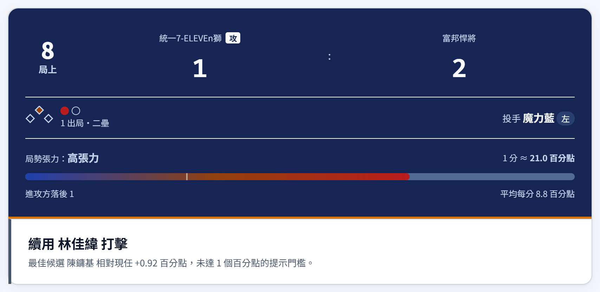
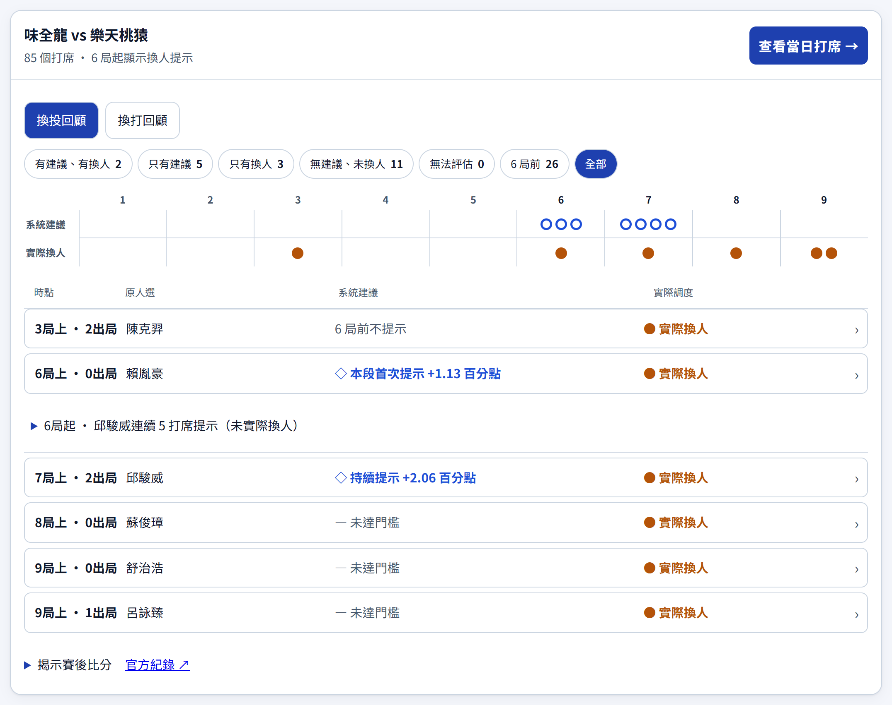
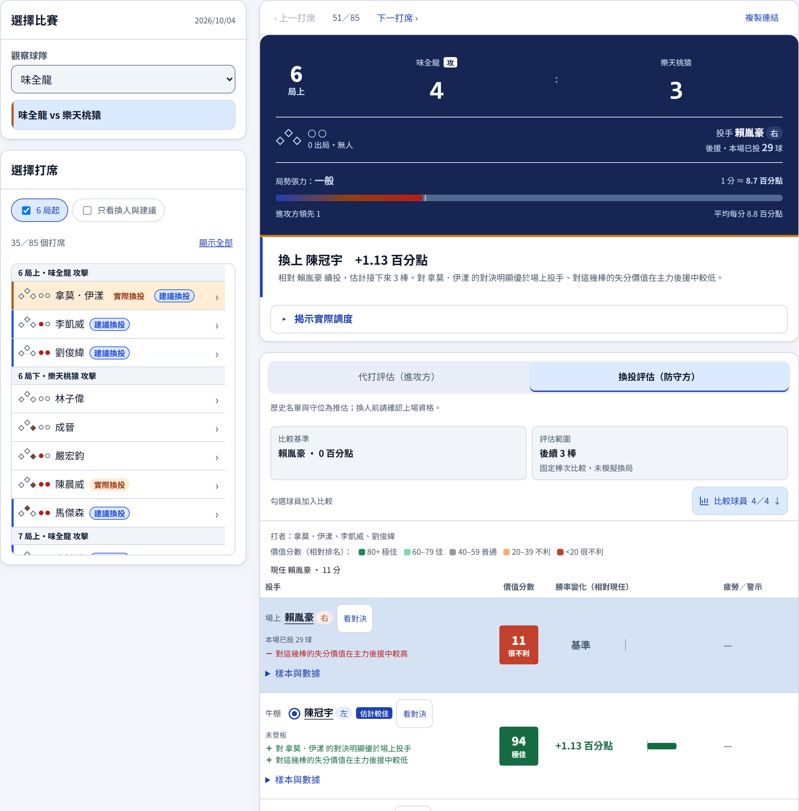

# 一球兩面 | 臨場用人決策

> 比賽打到關鍵打席，該讓現任打者續打、派代打，還是換投？
> 這個網站用中職公開資料，在**同一個局勢**下比較每位候選人選，回答教練最需要的三個問題：**差多少？誰接守？憑什麼？**

**線上網站：[一球兩面](https://da-xiong-chen.github.io/baseball_project/)**（免安裝，電腦與手機都能用）

## 目前版本與最新內容

網站以 **2026 球季**為主：球員、背號、預設先發與守位都是 2026 的資料，模型以 v5 方法用 2024–2026 三季逐球資料訓練。2026/10/04 單日回放只用該場比賽前的資料。

| 要找的內容 | 最新入口 |
|---|---|
| 最新網站、模型與資料驗收 | [11/14 改用 2026 球季資料](docs/qa/data-2026-20261114/README.md) · [11/12 回放、模型與瀏覽器驗收](docs/qa/replay-20261112/README.md) · [11/06 牛棚方案比較](docs/qa/release-foundation-20261106/README.md) |
| PR 檢查、異常操作與真實訓練驗收 | [10/29 最新發布前驗收](docs/qa/release-readiness-20261029/README.md) · [CI 執行方式](docs/ci-validation.md) |
| 本輪程式碼審查與修正 | [原始 Code Review](docs/qa/code-review-20261029/README.md) · [三項問題修正驗收](docs/qa/review-fixes-20261029/README.md) |
| 已完成及尚待採用的後續工作 | [年度進件、近況試跑與牛棚容量實作](docs/future-foundation-20261026.md) |
| 最新簡報工作稿 | [11/14、34 頁 2026 球季版 PPT／PDF](presentations/competition-2026/README.md#最新工作稿)；原交件版另外保留 |
| 最新模型實驗 | [2024–2026 打席與三棒失分比較](docs/qa/model-horizons-20261113/README.md) |
| 模型與身份基準 | [10/25 v5 整合驗收](docs/qa/identity-integration-20261025/README.md) |

**版本狀態**　2026 回放與首頁示範情境已隨 [PR #36](https://github.com/Da-Xiong-Chen/baseball_project/pull/36)、[PR #37](https://github.com/Da-Xiong-Chen/baseball_project/pull/37) 合併進 main，並發布到線上網站；也可依[本機執行](#本機執行)預覽。公開網站版本以 GitHub Pages 部署紀錄為準。

| 項目 | 內容 |
|---|---|
| 競賽 | 2026 野革盃 台灣棒球數據黑客松 |
| 隊名／成員 | 一球兩面｜蘇櫟、陳信安 |
| 參賽簡報 | [最新 34 頁工作稿（PPT／PDF）與原交件版](presentations/competition-2026/README.md) |
| 資料 | 2024–2026 中職一軍例行賽逐球紀錄（Rebas Open Data）與歷年守位 |



## 目錄

- [目前版本與最新內容](#目前版本與最新內容)
- [評審快速導覽](#評審快速導覽)
- [解決什麼問題](#解決什麼問題)
- [主要功能](#主要功能)
- [一個實際例子](#一個實際例子)
- [方法](#方法)
- [驗證結果](#驗證結果)
- [限制](#限制)
- [本機執行](#本機執行)
- [專案結構與文件](#專案結構與文件)
- [資料來源與授權](#資料來源與授權)
- [研究依據](#研究依據)

## 評審快速導覽

只有幾分鐘的話，建議依這個順序看：

| 想確認的事 | 去哪裡看 |
|---|---|
| 作品實際能做什麼 | 開啟[本機預覽](#本機執行)，選「一般使用者」→「換打／換投評估」，點「看示範情境」自動評估，或自行設定局勢與候選 |
| 系統的建議和教練實際調度差在哪 | 選「單日分析」→「逐打席回放」，選球隊與比賽後點選打席，再揭示實際調度及結果 |
| 方法和數據 | 本頁[方法](#方法)與[驗證結果](#驗證結果)；完整說明見 [docs/技術細節.md](docs/技術細節.md) |
| 驗證是否確實 | [11/12 單日回放驗收](docs/qa/replay-20261112/README.md)、[整體程式審查](docs/qa/code-review-20261029/README.md)、[v5 整合驗收](docs/qa/identity-integration-20261025/README.md)、[全部測試與驗收索引](docs/qa/README.md) |
| 提案內容 | [34 頁參賽簡報](presentations/competition-2026/README.md) |

**我們的四個重點：**

1. **比較基準一致**：所有候選都和「現任」比，現任固定為 0，正值就是估計較有利。不同人選之間的差距可以直接讀。
2. **不只比打擊，也檢查守備**：代打之後誰接守、守位排不排得出來、會不會多用掉一位板凳，都和打擊估計一起列出。
3. **小樣本不誇大**：替補和後援的對戰樣本很少，用部分池化把小樣本向整體基準收縮，避免幾個打席就下結論。
4. **歷史回放只用賽前資料**：回看 2026/10/04 的比賽時，能力、名單、負荷都只用比賽當天以前的資料，不偷看結果。

## 解決什麼問題

換人是教練在比賽中最常做、也最難事後評估的決定。數據網站多半只列出球員整季成績，但臨場需要的是另一種資訊：

- **差多少**：在「這個投手、這個局數、這個比分與壘況」下，換上誰比現任更有利？差距有多大？
- **誰接守**：代打之後守備排得出來嗎？需不需要再動用一位板凳？
- **憑什麼**：估計的依據是什麼？樣本夠不夠？兩個模型的看法一致嗎？

本作品的範圍是**打席與打席之間的換人決定**（代打、換投），不處理打席中的逐球策略。

## 主要功能

| 功能 | 說明 |
|---|---|
| **代打評估** | 設定局數、比分、壘況、出局、對方投手與輪到的打者，比較現任與最多四位板凳候選的勝率換算差距，並檢查換人後的接守安排 |
| **換投評估** | 輸入場上投手的本場球數，比較牛棚投手對上接下來三棒的差距，並納入用球數造成的疲勞 |
| **我方場上名單** | 用球場圖和棒次表安排九棒與投手，可用姓名或 2026 背號搜尋；球隊模式下，候選會自動排除場上球員 |
| **牛棚接續容量表** | 自行確認可用投手、剩餘打席容量及接續順位，以同一組投手和容量比較兩套接續順位，查看剩餘缺口及保留投手 |
| **2026 單日分析** | 回到 2026/10/04 的三場比賽（共 235 個打席），只用賽前資料看系統當時的建議，再依序揭示教練的實際調度與結果 |

網站上方有三個入口：

- **一般使用者**：直接挑人比較，適合球迷或分析者。
- **球隊**：先套用我方場上名單，候選只從板凳與牛棚中選，適合模擬實際用兵。
- **單日分析**：回顧 2026 年的真實比賽，對照系統提示與實際調度。





## 一個實際例子

> **情境**：8 局上，統一 1:2 落後富邦，一出局二壘有人。富邦左投魔力藍登板，輪到左打林佳緯。

1. 在一般使用者模式點「看示範情境」，系統會帶入上述局勢與林佳緯的指定打擊棒次。
2. 系統以林佳緯續打為 0，列出每位板凳候選的差距。最佳候選陳鏞基為 **+0.92 百分點**，表示估計勝率比林佳緯續打高約 0.92 個百分點。
3. 差距未達 1 個百分點的提示門檻，所以結論是「續用林佳緯打擊」。名單先顯示基準、前五名及已選入比較者，可按「顯示其餘」展開。

**怎麼讀數字：**

- **勝率差距（百分點）**：把「這個打席的得分期望差」依當下局勢換算成勝率。局勢越關鍵，同樣的打擊差距換算出的勝率差越大。
- **價值分數（1–100）**：候選在同一比較池中的相對位置，50 約為中位，**不是成功率**。
- 一般局面的代打差距通常在 1 個百分點以內，只有延長賽、九局比分接近等高張力局面才會明顯拉大。這是棒球單一打席本來就有的高隨機性。

## 方法

```
逐球與出賽資料 ─┬─ ① 部分池化模型：打者能力、左右投打、對各類球路的適性（小樣本向整體基準收縮）──┐
                └─ ② 梯度提升樹：沿用投手歷史投過的球，模擬候選打者的逐球結果並換算得分 ────────┴─ 各占一半
                                                                          → 依當下局勢換算成「勝率差距（百分點）」
```

- **兩個模型互補**：① 擅長處理樣本少的球員；② 能反映投手實際的進壘位置、球種與球數。兩者的每打席預期得分各占一半。
- **換算成勝率**：用歷史資料估計每個局勢「1 分值多少勝率」，例如 10 局下平手二三壘時 1 分約值 21% 勝率，全聯盟平均約 8.6%。
- **換投加入疲勞**：先發投手 85 球後依截止日前的資料估計疲勞調整；後援 30 球以上樣本太少，只提出警示。
- **守備檢查**：依過去出賽紀錄判斷球員能守哪些位置（某守位出賽 3 場以上才算），換人後重新排 9 人守位。

完整的模型設計、特徵與防止資料洩漏的做法，見 [docs/技術細節.md](docs/技術細節.md#3-模型與計算方式)。

## 驗證結果

我們依時間順序檢驗模型，並照實呈現結果，**包含尚未達到的部分**：

| 檢驗 | 結果 | 怎麼解讀 |
|---|---|---|
| 預測誤差 | v5 在 2025 年 9–10 月（5,396 打席）的得分預測誤差比聯盟基準低 0.19%，但 95% 區間跨零 | **尚不能確認優於基準**；不是全新未見資料的驗證 |
| 2026 離線模型 | 27,257 個相同打席上，時間順序集成與結果機率各半混合，RE24 MSE 由 0.226118 降到 0.225626 | 混合模型留作候選，實際換投後三棒排序沿用正式模型。[完整研究與重跑方式](docs/qa/model-horizons-20261113/README.md) |
| 換投時機 | 第 6 局起 11,868 個可評估換投決策點中，實際續投且有提示的 1,912 打席，進攻方 RE24 比未提示的 7,769 打席平均高 **+0.040 分**（依比賽重抽樣 95% 區間 +0.014 至 +0.064） | 觀察性的風險差異，**不能證明換投就會改善結果**；打席中換人不混入原投手的結果 |
| 數值一致性 | 最新回歸核對 18 組自訂情境與 275 場／498 組歷史代打回放；2026 固定單日另涵蓋 235 打席的 470 組攻守比較 | 這些是不同驗收母體，皆不是準確率；[單日重算](docs/qa/replay-20261112/history-day-parity.json) · [自訂與舊回放](docs/qa/code-review-20261029/numeric-parity.json) |
| 系統測試 | 完整資料掃描、Python／JavaScript 同情境對照，以及桌面、320／390px 瀏覽器操作分開驗收；本輪紀錄見下方連結 | 數值一致、操作可完成，不等同調度效益已證實 |

各項驗證的程序與原始紀錄見 [docs/技術細節.md](docs/技術細節.md#5-驗證與實驗)。

## 限制

- **名單與守位是推估的**：網站沒有官方當日登錄、傷病與退場資料，可用名單與守位由過去出賽推估，實際使用前需人工確認。
- **只看接下來三棒**：換投評估不考慮投手後續還能投幾局，也不是整場最適的牛棚安排。
- **2026 沒有留出樣本**：自訂評估的模型已用 2026 全季訓練，沒有未參與訓練的比賽可證明比 2024–2025 的版本更準；這次更新是讓網站反映 2026 的球員與表現。2026/10/04 單日回放另用該場賽前資料，逐球模型截止於 2026/10/01 前。
- **尚未納入**：代跑、守備好壞（目前只判斷能不能守）。

## 本機執行

只看網站與使用已匯出的靜態評估，不需下載原始資料或訓練模型：

```bash
python -m http.server 8000 --bind 127.0.0.1 --directory docs
```

開啟 `http://127.0.0.1:8000/`。這是目前 checkout 分支的版本，不是自動同步線上網站。

要使用 Python API、重算與資料分析，需 Python 3.10–3.11：

```bash
python -m pip install -r requirements.txt
python download_data.py      # 下載 Rebas 逐球資料與 ldkrsi 守位資料
python server.py             # 開啟 http://127.0.0.1:8000（Windows 也可雙擊「啟動系統.bat」）
```

訓練好的 v5 模型及批次描述（`models/active-batch.json`）已隨專案提供，執行現有功能不需要重新訓練。重訓請使用[候選模型訓練指南](docs/training-v5.md)，先固定來源並執行 dry-run；輸出保留在 output/，不直接覆寫正式模型。測試指令：

```bash
python -m unittest discover -s tests     # Python 測試
node --test tests/*.cjs                  # 前端測試（需 Node.js）
```

## 專案結構與文件

| 路徑 | 內容 |
|---|---|
| `docs/` | 網站前端（GitHub Pages），含瀏覽器內計算引擎 `engine.js` 與匯出資料 `docs/data/` |
| `src/` | 資料處理、模型、評估引擎與回測程式 |
| `server.py` | 本機完整版伺服器與 API |
| `models/` | 訓練好的模型權重 |
| `tests/` | Python 與前端測試 |
| `presentations/` | 參賽簡報 |

| 文件 | 適合誰看 |
|---|---|
| [docs/技術細節.md](docs/技術細節.md) | 想了解模型、實驗數據與限制的評審或開發者 |
| [docs/qa/README.md](docs/qa/README.md) | 想查各輪測試與驗收證據 |
| [資料來源.md](資料來源.md) | 想知道資料從哪裡來、怎麼下載 |
| [協作指南.md](協作指南.md) | 要參與開發的協作者 |
| [docs/archive/](docs/archive/README.md) | 早期規劃與測試報告（歷史紀錄） |

## 資料來源與授權

| 資料 | 來源 | 授權 |
|---|---|---|
| 2024–2026 逐球、打席、WPA、RE24 | [Rebas Open Data](https://github.com/rebas-tw/rebas.tw-open-data) | ODC-By v1.0 |
| 2026 守位 | Rebas 2026 逐打席守備陣容 | ODC-By v1.0 |
| 2022–2024 歷年守位 | [ldkrsi/cpbl-opendata](https://github.com/ldkrsi/cpbl-opendata) | MIT |
| 2025 守位與球員資料 | 中華職棒官網 | 僅供本競賽分析，著作權歸中華職棒 |

詳細下載位置與欄位說明見 [資料來源.md](資料來源.md)。

## 研究依據

1. Efron & Morris (1975). *Data Analysis Using Stein's Estimator and its Generalizations*. JASA 70(350). [DOI](https://doi.org/10.1080/01621459.1975.10479864)：小樣本估計向整體收縮，原文即以棒球打擊率為例。
2. Efron (1979). *Bootstrap Methods: Another Look at the Jackknife*. The Annals of Statistics 7(1). [DOI](https://doi.org/10.1214/aos/1176344552)：以比賽為單位重抽樣，描述結果的變動範圍。
3. Gneiting & Raftery (2007). *Strictly Proper Scoring Rules, Prediction, and Estimation*. JASA 102(477). [DOI](https://doi.org/10.1198/016214506000001437)：用嚴格的預測評分指標檢驗機率預測。

論文提供方法原理；在中職資料上的效果由本專案自行實驗驗證，見[驗證結果](#驗證結果)。
