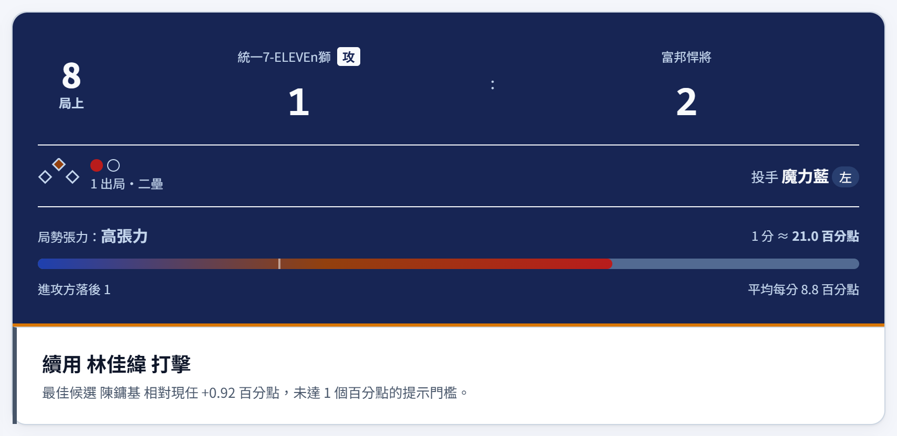
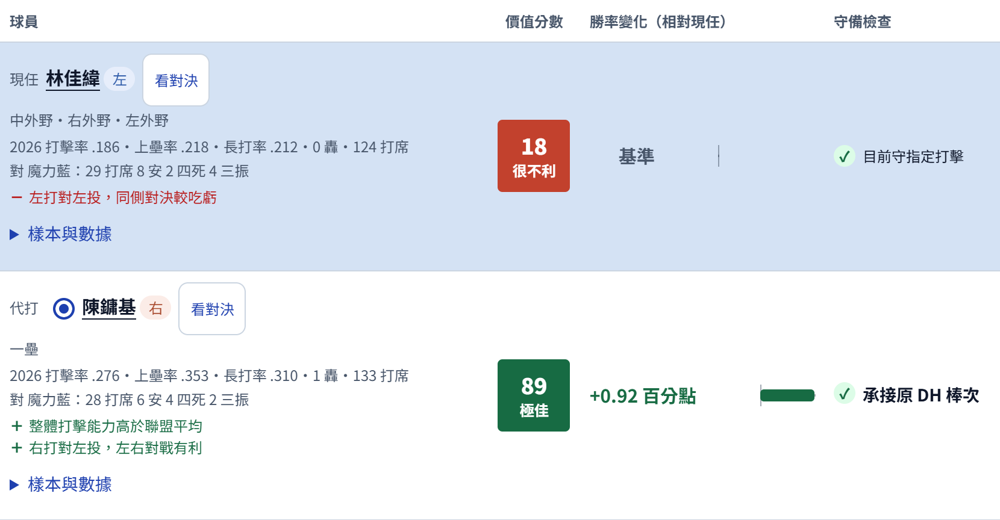
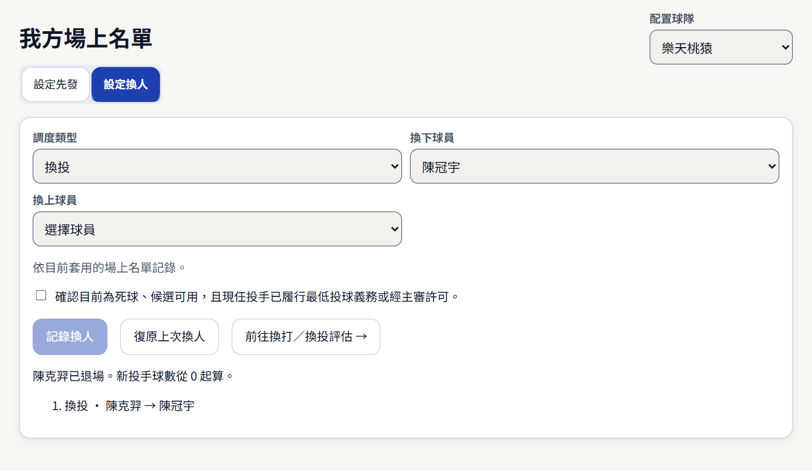
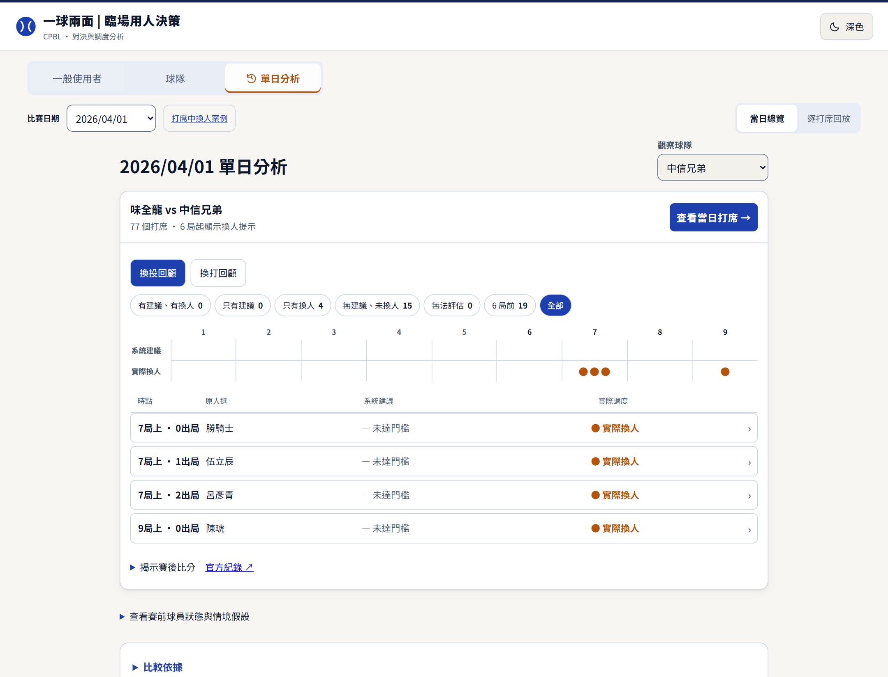
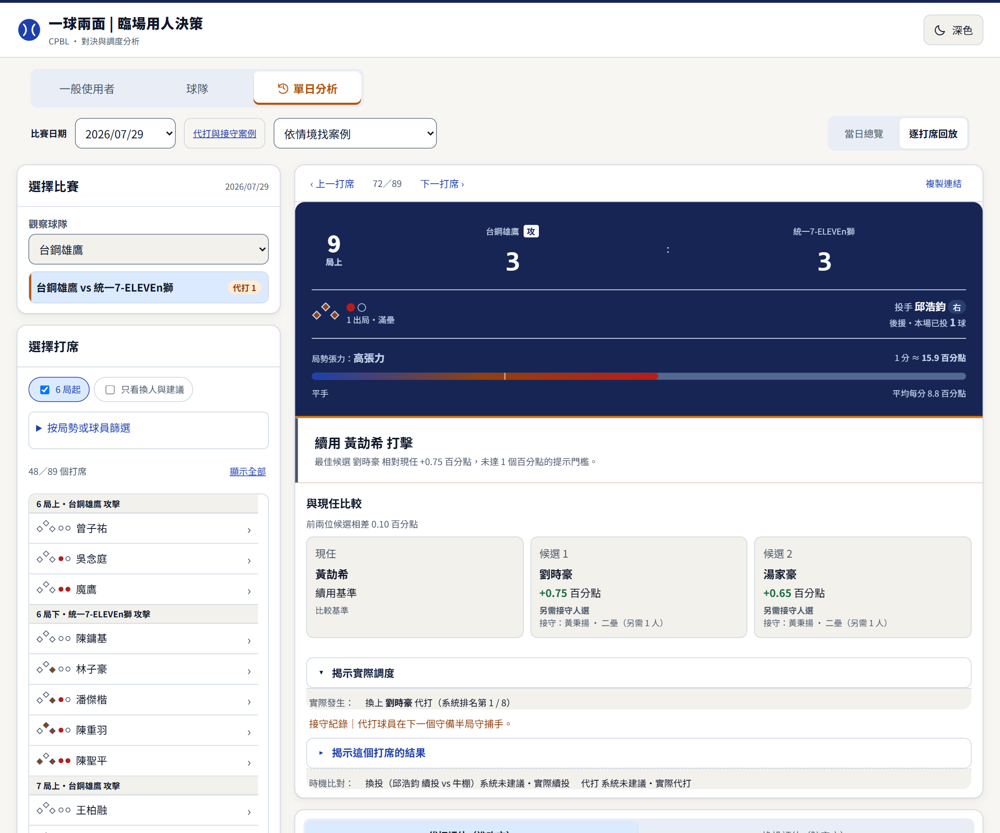

# 一球兩面 | 臨場用人決策

> 比賽打到關鍵打席，該讓現任打者續打、派代打，還是換投？
> 這個網站用中職公開資料，在**同一個局勢**下比較每位候選人選，回答教練最需要的三個問題：**差多少？誰接守？憑什麼？**

**線上網站：[一球兩面](https://da-xiong-chen.github.io/baseball_project/)**（免安裝，電腦與手機都能用）

## 目前版本與最新內容

網站以 **2026 球季**為主，球員、背號、預設先發與守位皆採用該季資料。自訂評估沿用 2024–2026 訓練的 v5 方法。單日分析提供 8 個比賽日，依日期使用該日以前的模型與球員資料。

| 要找的內容 | 最新入口 |
|---|---|
| 最新網站、模型與資料驗收 | [候選名單、接守與新球季演練](docs/qa/replay-evidence-20261116/README.md) · [專案收尾與發布驗收](docs/project-closeout-20261116.md) · [2026 球季資料](docs/qa/data-2026-20261114/README.md) |
| PR 檢查與瀏覽器異常操作 | [現行發布驗收](docs/project-closeout-20261116.md) · [CI 執行方式](docs/ci-validation.md) |
| 程式碼審查與修正 | [回放連結與本機 API](docs/project-closeout-20261116.md) · [11/6 整合審查](docs/qa/release-foundation-20261106/README.md) |
| 後續模型及資料工作 | [季中迭代的驗收方法](docs/qa/season-iteration-2026/README.md) · [資料來源與守位](資料來源.md) |
| 參賽簡報 | [38 頁工作稿 PPT／PDF](presentations/competition-2026/README.md#最新工作稿) · [原交件版](presentations/competition-2026/submission-20261023/README.md) |
| 最新模型實驗 | [2026 換投時機回測](docs/qa/timing-2026/README.md) · [疲勞調整與勝率校準](docs/qa/website-roadmap-20261115/README.md) · [季中迭代](docs/qa/season-iteration-2026/README.md) |
| 模型與身份基準 | [10/25 v5 整合驗收](docs/qa/identity-integration-20261025/README.md) |

**版本狀態**　8 個比賽日回放、球隊調度與 2026 模型驗收已隨 [PR #38](https://github.com/Da-Xiong-Chen/baseball_project/pull/38) 合併並部署到 GitHub Pages。可依[本機執行](#本機執行)預覽，也可查閱[部署紀錄](https://github.com/Da-Xiong-Chen/baseball_project/deployments)。

| 項目 | 內容 |
|---|---|
| 競賽 | 2026 野革盃 台灣棒球數據黑客松 |
| 隊名／成員 | 一球兩面｜蘇櫟、陳信安 |
| 參賽簡報 | [最新 38 頁工作稿（PPT／PDF）與原交件版](presentations/competition-2026/README.md) |
| 資料 | 2024–2026 中職一軍例行賽逐球紀錄（Rebas Open Data）與歷年守位 |



## 目錄

- [目前版本與最新內容](#目前版本與最新內容)
- [評審快速導覽](#評審快速導覽)
- [解決什麼問題](#解決什麼問題)
- [主要功能](#主要功能)
- [一個實際例子](#一個實際例子)
- [方法](#方法)
- [驗證結果](#驗證結果)
- [限制](#限制)
- [本機執行](#本機執行)
- [專案結構與文件](#專案結構與文件)
- [資料來源與授權](#資料來源與授權)
- [研究依據](#研究依據)

## 評審快速導覽

只有幾分鐘的話，建議依這個順序看：

| 想確認的事 | 去哪裡看 |
|---|---|
| 作品實際能做什麼 | 開啟[本機預覽](#本機執行)，選「一般使用者」→「換打／換投評估」，點「看示範情境」自動評估，或自行設定局勢與候選 |
| 系統的建議和教練實際調度差在哪 | 選「單日分析」，選日期、球隊與比賽，或直接開啟當天的代表案例，再揭示實際調度及結果 |
| 方法和數據 | 本頁[方法](#方法)與[驗證結果](#驗證結果)；完整說明見 [docs/技術細節.md](docs/技術細節.md) |
| 驗證是否確實 | [八日回放數值核對](docs/qa/website-roadmap-20261115/replay-verification.json) · [網站與 API 操作驗收](docs/project-closeout-20261116.md) · [全部測試與驗收索引](docs/qa/README.md) |
| 提案內容 | [38 頁參賽簡報](presentations/competition-2026/README.md) |

**我們的四個重點：**

1. **比較基準一致**：所有候選都和「現任」比，現任固定為 0，正值就是估計較有利。不同人選之間的差距可以直接讀。
2. **不只比打擊，也檢查守備**：代打之後誰接守、守位排不排得出來、會不會多用掉一位板凳，都和打擊估計一起列出。
3. **小樣本不誇大**：替補和後援的對戰樣本很少，用部分池化把小樣本向整體基準收縮，避免幾個打席就下結論。
4. **歷史回放採時間前推**：能力、名單與負荷只用比賽當日以前的資料。逐球模型的訓練與校準截止於該月月初以前。

## 解決什麼問題

換人是教練在比賽中最常做、也最難事後評估的決定。數據網站多半只列出球員整季成績，但臨場需要的是另一種資訊：

- **差多少**：在「這個投手、這個局數、這個比分與壘況」下，換上誰比現任更有利？差距有多大？
- **誰接守**：代打之後守備排得出來嗎？需不需要再動用一位板凳？
- **憑什麼**：估計的依據是什麼？樣本夠不夠？兩個模型的看法一致嗎？

本作品的範圍是**打席與打席之間的換人決定**（代打、換投），不處理打席中的逐球策略。

## 主要功能

| 功能 | 說明 |
|---|---|
| **代打評估** | 設定局數、比分、壘況、出局、對方投手與輪到的打者，比較現任與最多四位板凳候選的勝率換算差距。按「換上」前可預覽接守人選與守位 |
| **換投評估** | 輸入場上投手的本場球數，比較牛棚投手對上接下來三棒的差距與疲勞調整。手機先顯示現任與最多兩位候選，展開可看完整比較 |
| **我方場上名單** | 用球場圖和棒次表安排九棒與投手，可用姓名或 2026 背號搜尋；球隊模式下，候選會自動排除場上球員 |
| **牛棚接續容量表** | 從換投結果把候選帶到方案 A／B 的第一順位，以自行確認的剩餘容量比較後續缺口和保留投手。換投或換隊後，請以目前牛棚重新計算；復原到原配置可繼續使用原方案設定 |
| **換人後自動更新可用人選** | 確認代打後更新原棒次與接守安排；確認換投後新投手球數從 0 起算。已退場球員從本場候選排除，系統以新名單重算。球隊模式同步保存名單 |
| **季成績與對戰紀錄** | 展開「季成績與對戰」才載入自訂評估的 2026 季成績與 2024–2026 對戰資料，供對照現任或候選 |
| **2026 單日分析** | 從 8 個比賽日按日期或情境找案例，可依比分、壘況、調度類型或球員篩選。先看賽前評估，再揭示實際調度和代打後接守。可複製該打席連結 |
| **球隊配置備份** | 下載或匯入同隊同季的草稿，包含待確認的接守守位。匯入後可先檢視與調整，再套用到評估頁 |
| **代打與調度紀錄** | 先預覽代打與接守，再確認換上。需另外安排接守時，球隊名單會標記「接守待確認」，直到使用者確認配置。可逐次復原換人，並查看名單保存結果 |





網站上方有三個入口：

- **一般使用者**：直接挑人比較，適合球迷或分析者。
- **球隊**：先套用我方場上名單，候選只從板凳與牛棚中選，適合模擬實際用兵。
- **單日分析**：回顧 2026 年的真實比賽，對照系統提示與實際調度。

可以直接開啟 [4/1 打席中換人](https://da-xiong-chen.github.io/baseball_project/?replay=2026-04-01&game=2026-010&pa=2026-010-a034&decision=pen) 或 [7/29 代打後實際接守](https://da-xiong-chen.github.io/baseball_project/?replay=2026-07-29&game=2026-229&pa=2026-229-a036&decision=ph)。在 7/29 案例展開「揭示實際調度」可查看下一個守備半局的捕手安排。





## 一個實際例子

> **情境**：8 局上，統一 1:2 落後富邦，一出局二壘有人。富邦左投魔力藍登板，輪到左打林佳緯。

1. 在一般使用者模式點「看示範情境」，系統會帶入上述局勢與林佳緯的指定打擊棒次。
2. 系統以林佳緯續打為 0，列出每位板凳候選的差距。最佳候選陳鏞基為 **+0.92 百分點**，表示估計勝率比林佳緯續打高約 0.92 個百分點。
3. 差距未達 1 個百分點的提示門檻，所以結論是「續用林佳緯打擊」。名單先顯示基準、前五名及已選入比較者，可按「顯示其餘」展開。

**怎麼讀數字：**

- **勝率差距（百分點）**：把「這個打席的得分期望差」依當下局勢換算成勝率。局勢越關鍵，同樣的打擊差距換算出的勝率差越大。
- **價值分數（1–100）**：候選在同一比較池中的相對位置，50 約為中位，**不是成功率**。
- 一般局面的代打差距通常在 1 個百分點以內，只有延長賽、九局比分接近等高張力局面才會明顯拉大。這是棒球單一打席本來就有的高隨機性。

## 方法

```
逐球與出賽資料 ─┬─ ① 部分池化模型：打者能力、左右投打、對各類球路的適性（小樣本向整體基準收縮）──┐
                └─ ② 梯度提升樹：沿用投手歷史投過的球，模擬候選打者的逐球結果並換算得分 ────────┴─ 各占一半
                                                                          → 依當下局勢換算成「勝率差距（百分點）」
```

- **兩個模型互補**：① 擅長處理樣本少的球員；② 能反映投手實際的進壘位置、球種與球數。兩者的每打席預期得分各占一半。
- **換算成勝率**：用歷史資料估計每個局勢「1 分值多少勝率」，例如 10 局下平手二三壘時 1 分約值 21% 勝率，全聯盟平均約 8.6%。
- **換投加入疲勞**：先發投手 85 球後依截止日前的資料估計疲勞調整；後援 30 球以上樣本太少，只提出警示。
- **守備檢查**：依過去出賽紀錄判斷球員能守哪些位置（某守位出賽 3 場以上才算），換人後重新排 9 人守位。

完整的模型設計、特徵與防止資料洩漏的做法，見 [docs/技術細節.md](docs/技術細節.md#3-模型與計算方式)。

## 驗證結果

我們依時間順序檢驗模型，並照實呈現結果，**包含尚未達到的部分**：

| 檢驗 | 結果 | 怎麼解讀 |
|---|---|---|
| 預測誤差 | v5 方法（2024–2025 訓練）在 2025 年 9–10 月（5,396 打席）的得分預測誤差比聯盟基準低 0.19%，但 95% 區間跨零 | **尚不能確認優於基準**；不是全新未見資料的驗證。網站現行批次沿用同一方法、改用 2024–2026 訓練，沒有另外的留出驗證 |
| 2026 離線模型 | 27,257 個相同打席上，時間順序集成與結果機率各半混合，RE24 MSE 由 0.226118 降到 0.225626 | 混合模型留作候選，實際換投後三棒排序沿用正式模型。[完整研究與重跑方式](docs/qa/model-horizons-20261113/README.md) |
| 換投時機 | 2026 例行賽第 6 局起 11,958 筆可評估換投決策。實際續投且可比較 RE24 的打席中，有換投提示／無提示各 1,831／7,911 筆，進攻方 RE24 平均差 **+0.013 分／打席**（95% 比賽重抽樣區間 −0.012 至 +0.037） | 以 1 百分點為提示門檻，比較兩組在實際續投時的觀察結果。[回測與驗收](docs/qa/timing-2026/README.md) |
| 疲勞調整 | 2026 同樣本 9,044 個三棒視窗，開啟現行疲勞項的失分 MSE 較關閉高 0.000845，95% 比賽配對區間 +0.000564 至 +0.001130 | 95 球以上先發組也呈現同方向。結果用於離線診斷，正式權重待新賽季前瞻驗證。[多日回放與模型驗收](docs/qa/website-roadmap-20261115/README.md) |
| 季中迭代 | 2026 例行賽 24 週、88,179 球，每週以當時資料重建、預測下一週：近期加權（半衰期 30／60 天）都沒有更準，打者 30 天顯著變差（95% 區間 −0.358 至 −0.037） | 網站維持不加權；每週重跑 `scripts/season_iteration.py` 即可再檢查。[完整紀錄](docs/qa/season-iteration-2026/README.md) |
| 數值一致性 | 自訂評估核對 54 組情境的 1,962 個數值。八日回放核對 1,873 個打席的 3,746 組攻守比較與 1,692 筆調度標記 | 驗證 Python 重算與網站匯出一致。[自訂評估](docs/qa/data-2026-20261114/README.md) · [八日回放](docs/qa/website-roadmap-20261115/replay-verification.json) |
| 系統測試 | 完整資料掃描、Python／JavaScript 同情境對照，以及桌面、320／390px 瀏覽器操作分開驗收；本輪紀錄見下方連結 | 數值一致、操作可完成，不等同調度效益已證實 |

各項驗證的程序與原始紀錄見 [docs/技術細節.md](docs/技術細節.md#5-驗證與實驗)。

## 限制

- **名單與守位是推估的**：網站沒有官方當日登錄、傷病與退場資料，可用名單與守位由過去出賽推估，實際使用前需人工確認。
- **只看接下來三棒**：換投評估不考慮投手後續還能投幾局，也不是整場最適的牛棚安排。
- **兩種模型用途**：網站自訂評估的季後模型用 2024–2026 三季資料訓練。2026 單日回放與全季換投時機回測採賽前資料，依月初截止使用逐球樹模型，依比賽日期重建階層式模型。全季回測比較實際續投的觀察結果。
- **尚未納入**：代跑、守備好壞（目前只判斷能不能守）。

## 本機執行

只看網站與使用已匯出的靜態評估，不需下載原始資料或訓練模型：

```bash
python -m http.server 8000 --bind 127.0.0.1 --directory docs
```

開啟 `http://127.0.0.1:8000/`。這是目前 checkout 分支的版本，不是自動同步線上網站。

要使用 Python API、重算與資料分析，需 Python 3.10–3.11：

```bash
python -m pip install -r requirements.txt
python download_data.py      # 下載 Rebas 2024–2026 逐球資料、ldkrsi 守位，並整理 2026 守位
python start_server.py       # 開啟 http://127.0.0.1:8000（Windows 也可雙擊「啟動系統.bat」）
```

`start_server.py` 的自訂評估使用與網站相同的 2026 球季批次（`models/2026/`）。已公開的歷史比賽可由回放 API 讀取原匯出結果。離線重新計算歷史結果需要對應的月初權重和批次合約。直接執行 `python server.py` 採 2024–2025 v5 批次，供重現舊驗收使用。

訓練好的 2026 季後模型在 `models/2026/`。現有功能可直接使用。如需重現實驗，從[三季資料驗收](docs/qa/data-2026-20261114/README.md)與[2026 月初模型及換投時機回測](docs/qa/timing-2026/README.md)查閱資料、截止日及批次。[舊 v5 訓練指南](docs/training-v5.md)可重現 2024–2025 批次。

```bash
python scripts/run_ci.py                 # 前端、靜態資料、文件與 Python fixture（需 Node.js）
python -m unittest discover -s tests     # 完整 Python：需三季逐球資料
```

## 專案結構與文件

| 路徑 | 內容 |
|---|---|
| `docs/` | 網站前端（GitHub Pages），含瀏覽器內計算引擎 `engine.js` 與匯出資料 `docs/data/` |
| `src/` | 資料處理、模型、評估引擎與回測程式 |
| `server.py` | 本機完整版伺服器與 API |
| `models/` | 訓練好的模型權重 |
| `tests/` | Python 與前端測試 |
| `presentations/` | 參賽簡報 |

| 文件 | 適合誰看 |
|---|---|
| [docs/技術細節.md](docs/技術細節.md) | 想了解模型、實驗數據與限制的評審或開發者 |
| [docs/qa/README.md](docs/qa/README.md) | 想查各輪測試與驗收證據 |
| [資料來源.md](資料來源.md) | 想知道資料從哪裡來、怎麼下載 |
| [協作指南.md](協作指南.md) | 要參與開發的協作者 |
| [docs/ci-validation.md](docs/ci-validation.md) | 要重跑 CI、瀏覽器操作、發布與回復核對的維護者 |
| [docs/archive/](docs/archive/README.md) | 早期規劃與測試報告（歷史紀錄） |

## 資料來源與授權

| 資料 | 來源 | 授權 |
|---|---|---|
| 2024–2026 逐球、打席、WPA、RE24 | [Rebas Open Data](https://github.com/rebas-tw/rebas.tw-open-data) | ODC-By v1.0 |
| 2026 守位 | Rebas 2026 逐打席守備陣容 | ODC-By v1.0 |
| 2022–2024 歷年守位 | [ldkrsi/cpbl-opendata](https://github.com/ldkrsi/cpbl-opendata) | MIT |
| 2025 守位與球員資料 | 中華職棒官網 | 僅供本競賽分析，著作權歸中華職棒 |

詳細下載位置與欄位說明見 [資料來源.md](資料來源.md)。

## 研究依據

1. Efron & Morris (1975). *Data Analysis Using Stein's Estimator and its Generalizations*. JASA 70(350). [DOI](https://doi.org/10.1080/01621459.1975.10479864)：小樣本估計向整體收縮，原文即以棒球打擊率為例。
2. Efron (1979). *Bootstrap Methods: Another Look at the Jackknife*. The Annals of Statistics 7(1). [DOI](https://doi.org/10.1214/aos/1176344552)：以比賽為單位重抽樣，描述結果的變動範圍。
3. Gneiting & Raftery (2007). *Strictly Proper Scoring Rules, Prediction, and Estimation*. JASA 102(477). [DOI](https://doi.org/10.1198/016214506000001437)：用嚴格的預測評分指標檢驗機率預測。

論文提供方法原理；在中職資料上的效果由本專案自行實驗驗證，見[驗證結果](#驗證結果)。
