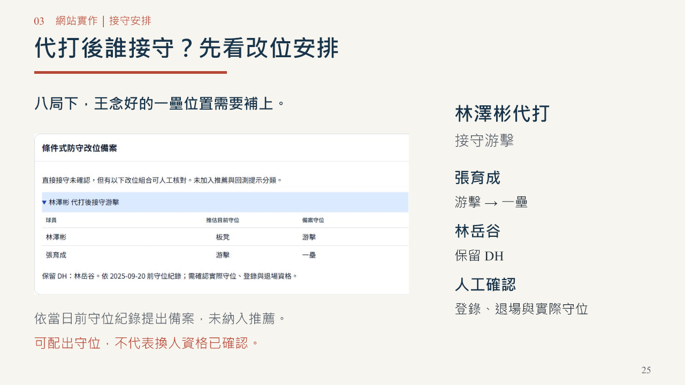

# 網站與32頁初審提案驗收｜2026-10-23

本輪從已合併PR #26的main `aa7d8fb`接續，在`release/competition-readiness-20261023`完成兩項網站呈現修正及使用者確認的兩頁PPT更新。所有正式數值JSON、9份v4權重、推薦門檻與模型採用決策均未變動。

## 本輪修正

- 配球卡片改用中性標題「近期配球比較」。嚴格樣本不足而呈現原始觀察圖時，直接交代原因，避免被誤認為調整後的趨勢結論。可切回同條件比較，仍如實顯示不足。
- 代打接守備案只在代打視角顯示。實際操作發現換投視角誤顯示備案，已修正，並驗證切換後較晚回來的成功或失敗回應都不會重新寫入。
- PPT第20頁補上原始配球視角適用範圍；第25頁改為接守實際案例。隊名確認後另更新第1頁；其餘29頁相較上一輪audited版slide XML逐位元相同，第26頁影片不變。依使用者確認保留32頁、淺色、中文標楷體／DFKai-SB、英文及數字Times New Roman；0備忘稿、動畫、轉場。

## 初審內容對照

2026-10-23透過瀏覽器重新閱讀[官方公開簡章](https://blog.rebas.tw/articles/4136)，六項要求皆有對應內容。這是內容完整性判斷，不代表評審錄取或表單已提交。

| 初審要求 | 提案頁面 | 呈現內容 |
|---|---|---|
| 希望解決的棒球問題 | 4、6 | 同一關鍵局勢下的代打／換投人選比較 |
| 目標使用者與情境 | 5、7 | 一般與球隊模式、獨立單日分析 |
| 使用資料 | 9 | Rebas逐球、歷年守位、CPBL球員資料與日期界線 |
| 分析方法 | 10–14 | 階層式／GBT集成、單位、時間檢查、觀察式回測 |
| 產品構想 | 16–26 | 可操作的比較、名單、配球、回放、接守安排及Demo |
| 預期成果與開發規劃 | 12、28–30 | 既有成果限制、跨年接續、近況權重、多局牛棚 |

## 驗收結果

| 項目 | 結果 | 證據 |
|---|---|---|
| 前端 | 170項通過 | node-tests.log |
| Python | 88項通過，Python來源未變 | python-tests.log |
| 固定日真實HTTP流程 | 226打席、452視圖、7953明細通過 | http-workflow-final-host.log |
| API | evaluate、detail、replay、team、games、配球；11種非法參數檢查通過 | http-report.json |
| 數值 | 681個JSON、1848007個數值、39420組配球列，0錯誤 | numeric-audit.json |
| 封版 | 數值與權重不變；僅app.js、pitch-change.js及manifest更新 | seal-verification.json、seal-ui-fix.json |
| 實際瀏覽器 | 桌面1265px與手機390×844的評估／配球／模型驗證頁無整頁溢出；主控台0警告／錯誤 | browser-evidence.json、mobile-comparison.jpg |
| 回放揭示 | 先人選，再實際調度，再結果；換投視角不顯示代打備案 | browser-evidence.json |
| PPT／PDF | 32頁容量與逐頁渲染檢查，全文及超連結一致，字型與封裝通過 | artifact-verification.json、font-audit.json、delivery-check.json |

PPT檢查器僅有未嵌入標楷體的可攜性提醒，0結構錯誤。同版PDF提供固定版面。兩項受限執行環境問題已排除：首次HTTP測試無法跨沙箱連線，改在主機環境通過；封裝檢查的暫存目錄權限問題，改用工作區暫存目錄後通過。失敗嘗試的紀錄留在本機output，沒有把它們算成通過。

## 資料限制與可交付範圍

可作為本屆初審提案與功能展示版本。歷史名單／守位仍為推估；36個原接守缺口中只有6個有條件式備案，未擅改為有效推薦。樣本不足可觀察原始配球，不代表小樣本已可靠。時間檢查尚不足以證明優於聯盟基準；不採用尾端不穩定的聯合模型區間，不宣稱回測為換人因果效益。2026資料與多局牛棚規劃仍列後續工作。

代理操作測試不是外部真人測試，也沒有虛構滿意度或成效。現有證據未顯示阻斷初審展示的功能缺陷，並不構成所有裝置或情境永無錯誤的保證。

正式隊名已依使用者2026-10-23指示定為「一球兩面」，已同步封面、PDF與交付說明。正式交件前待確認兩項：登入後表單接受的格式／檔案大小；報告電腦上的PowerPoint影片點播。第26頁為36秒真實UI截圖剪輯，並非連續錄影；嵌入影片位元組與外附MP4一致，未宣稱原生PowerPoint播放已驗證。

公開簡章可讀，但報名表單轉到accounts.google.com後，瀏覽器自動審查拒絕未授權的私人帳戶讀取；未繞過或進入登入流程。表單格式限制因此尚未確認。

## 版本與交付

[最新PPT、PDF與影片](../../../presentations/competition-2026/submission-20261023/README.md)。雜湊見該目錄checksums.json。

PR #26已合併，公開站v4模型及回放腳本與基礎版本位元組相符；見public-version.json。本輪新修改依使用者授權，透過獨立分支release/competition-readiness-20261023及新PR提交審閱，不直接合併或部署。公開網站仍須於本輪修改發布後核對manifest與實際操作。
