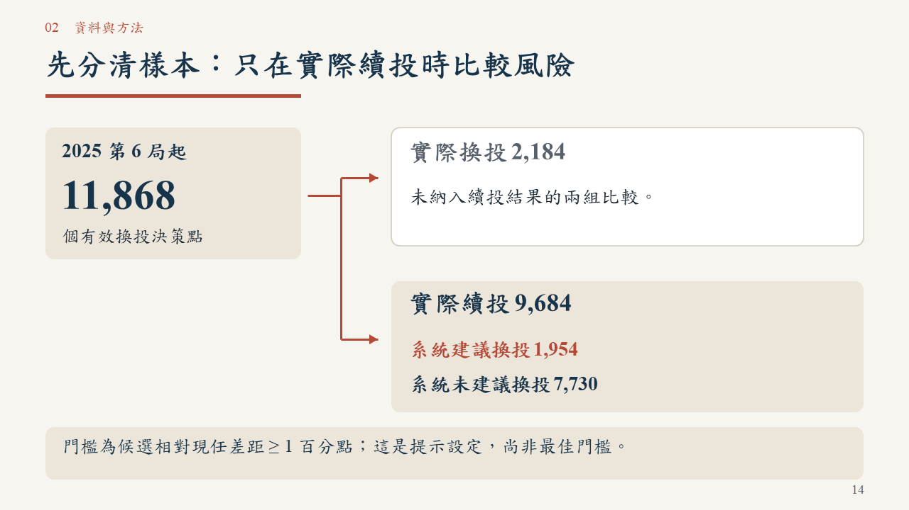
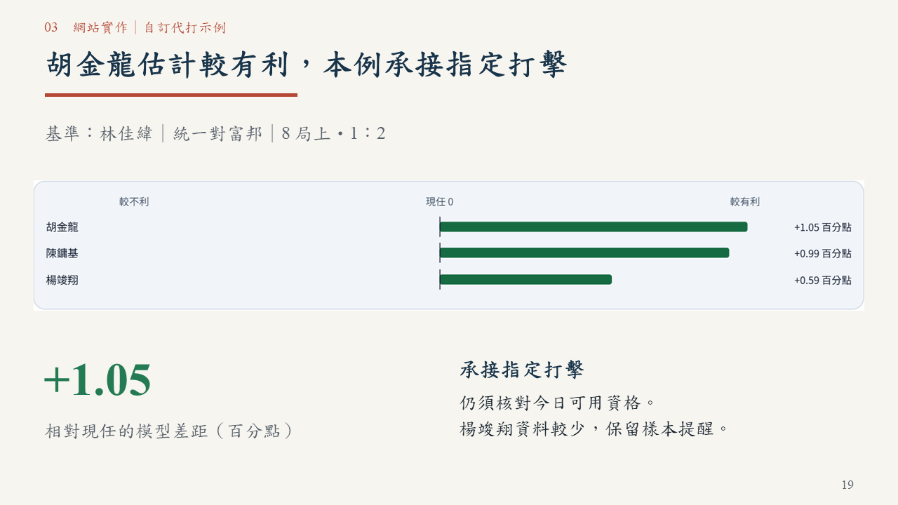

# 一球兩面｜臨場用人決策：正式競賽提案

[下載 PowerPoint（40 頁，含影片）](一球兩面_正式競賽版_40頁_評審閱讀優化_20261020.pptx) · [閱讀 PDF](一球兩面_正式競賽版_40頁_評審閱讀優化_20261020.pdf)

隊名：一球兩面。參賽者：蘇櫟、陳信安。供初審評審獨立閱讀；成果指網站功能，簡報是提案材料。

網站：https://da-xiong-chen.github.io/baseball_project/

原始碼：https://github.com/Da-Xiong-Chen/baseball_project

## 本版重點

沿用四章、網站截圖優先、奶油白／深藍／磚紅與自然對齊。中文標楷體，英數 Times New Roman。第 33 頁保留 25.2 秒實際操作影片；PDF 為靜態畫面，案例說明不依賴播放。

新增兩頁交代驗證範圍與樣本篩選，補齊 11,868 個有效換投決策點中 2,184 個實際換投、9,684 個續投的去向。RE24 組間差使用「分／打席」，區間依既有程式標為常態近似、未依比賽群聚校正，不誤稱 Bootstrap。1 百分點只是目前提示設定，不當成已證明最佳門檻。

一般使用者與球隊限制、自訂示例與歷史回放、模型估計與實際結果分開說明。2026、近期權重與實務新功能明列為後續規劃；舊模型成效不代替 v2 結果。本輪未修改網站、資料、模型或評分。另刪除 8 頁底部重複補充及底色條，保留必要的資料日期、樣本／單位、研究限制與來源。

## 六項初審要求對照

| 要求 | 頁面 |
|---|---|
| 希望解決的棒球問題 | 4、6–7 |
| 目標使用者與使用情境 | 5、8、17–20 |
| 預計使用的資料 | 10、28、36 |
| 分析方法 | 11–15、28、39 |
| 產品構想 | 6–8、17–33 |
| 預期成果與開發規劃 | 35–38 |

## 判讀與驗收

第 13 頁的 452 組是既有單日雙向工程對照，不是預測命中率；第 14–15 頁的全季觀察性研究不是換投因果效益；第 26 頁的 226 打席是示範涵蓋量。自訂情境的候選差距也不是換人成功率。

40 頁容量檢查零錯誤／警告。PowerPoint 原生全頁輸出及另存重開通過，438 個文字物件無超出頁面，指定字型核對通過；PDF 40 頁均可搜尋。影片與來源位元組一致、全片解碼通過，未另作滑鼠點播。標楷體未宣稱內嵌，附 PDF 供跨裝置閱讀。

詳見 [本輪修訂與驗收](REVISION-20261020.md) 與 [機器可讀驗證](評審閱讀版驗證紀錄_40頁.json)。網站既有驗收見 [單日驗收紀錄](../../docs/qa/day-release-20261019/README.md)，本次沒有重跑網站或訓練模型。

舊 38 頁及更早版本保留供追溯；本次請使用上述 40 頁檔案。
