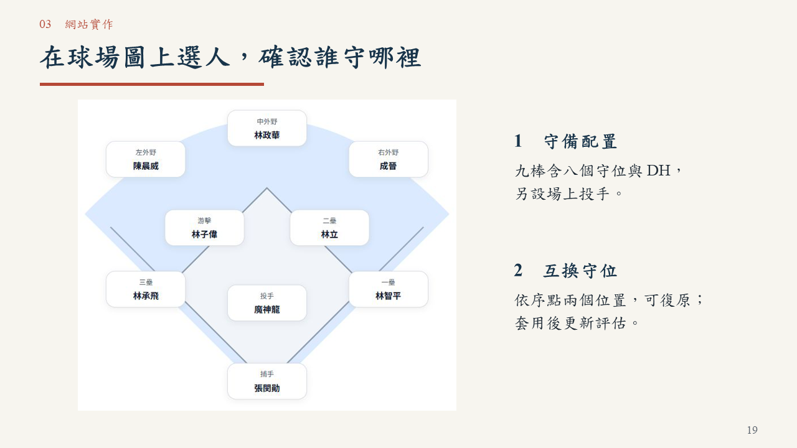
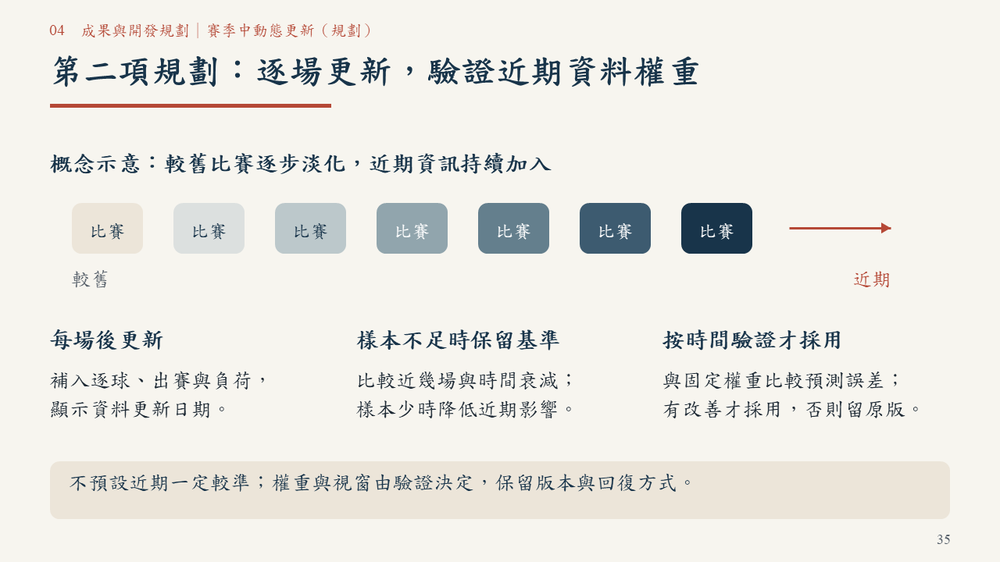

# 一球兩面｜臨場用人決策：正式競賽提案

[下載 PowerPoint（38 頁，含影片）](一球兩面_正式競賽版_38頁_圖解整合_20261019.pptx) · [閱讀 PDF](一球兩面_正式競賽版_38頁_圖解整合_20261019.pdf)

隊名：一球兩面。參賽者：蘇櫟、陳信安。供初審評審獨立閱讀；成果指網站功能，簡報是提案材料。

網站：https://da-xiong-chen.github.io/baseball_project/

原始碼：https://github.com/Da-Xiong-Chen/baseball_project

## 本版呈現方式

保留 38 頁及四張換章頁，使用棒球情境、球場、名單、時間軸、投手負荷日曆與實際網站截圖解釋操作和判讀。中文為標楷體、英數為 Times New Roman，依內容對齊。第 31 頁保留 25.2 秒實際操作影片；PDF 以靜態畫面呈現，前面案例仍提供完整判讀資訊。

第 34–36 頁是後續規劃：接入 2026、逐場更新與近期權重驗證、名單／退場／負荷及逐場回放。2026 尚未接入本版，權重示意不是實際模型參數；本輪未修改網站與模型。

## 六項初審要求對照

| 要求 | 頁面 |
|---|---|
| 希望解決的棒球問題 | 4、6–7 |
| 目標使用者與使用情境 | 5、8、15–18 |
| 預計使用的資料 | 10、26、34 |
| 分析方法 | 11–13、26、37 |
| 產品構想 | 6–8、15–31 |
| 預期成果與開發規劃 | 33–36 |

## 可重現的網站案例與限制

- 代打：統一對富邦，8 局上 1：2、一出局二壘有人；魔力藍對林佳緯（DH），比較胡金龍、陳鏞基、楊竣翔。胡金龍相對現任 +1.05 百分點。
- 換投：魔神龍已投 95 球，固定接下來三棒；朱承洋在已選後援中 +2.51 百分點，未模擬後續局數或整場調度。
- 配球：魔力藍對右打，2025/09/20 賽前兩期 428／258 球；低落類 18%→34%、速球類 53%→41%。低落為球種分類，不代表落點或效果提升。
- 單日分析：2025/09/20 六隊三場共 226 打席，全部可切換代打與換投。能力估計截至賽前，逐球模型截至 9/1。
- 回放案例：郭永維相對林家鋐 +0.54 百分點，未達 1 百分點門檻；實際對魔力藍代打為一壘安打。單次結果不能判定調度優劣。

全季有效換投比較 11,868 個，+0.043（95% 區間 +0.017～+0.068）是實際續投打席的組間 RE24 差，不能推論換投的因果效益。代打差異尚不明顯。單日回放與全季研究分開說明。

## 驗收

38 頁容量檢查通過；PowerPoint 兩輪原生輸出、另存重開，419 個文字物件無超出頁面，字型符合指定。影片位元組保留並完整解碼，原生辨識第 31 頁／25,200 毫秒。PDF 38 頁可搜尋；結構、數據、長條尺度及完整網址已核對。未另做滑鼠點播測試。

詳見 [修改與驗收紀錄](REVISION-20261019-VISUAL.md) 及 [機器可讀驗證](圖解版驗證紀錄_38頁.json)。既有網站驗收見 [單日分析測試](../../docs/qa/day-release-20261019/README.md)。

舊 34 頁及 22 頁檔案保留供歷程追溯；以本頁連結的 38 頁圖解整合版作為本次交付。
