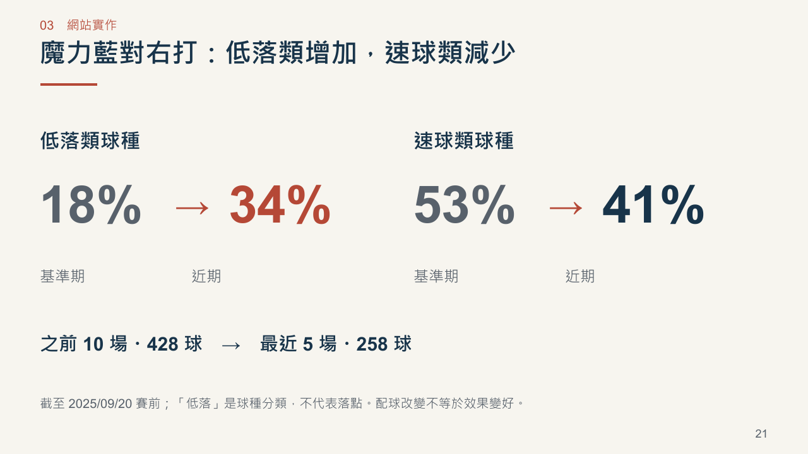

# 一球兩面｜臨場用人決策：正式參賽提案

[下載 PowerPoint（34 頁）](一球兩面_正式參賽提案_34頁_20261019.pptx) · [閱讀 PDF](一球兩面_正式參賽提案_34頁_20261019.pdf)

隊名：一球兩面。參賽者：蘇櫟、陳信安。

供初審獨立閱讀，沿用淺色棒球記分卡風格，加入四張換章頁。重要數字放大，網站截圖裁切至要說明的區域；概念與操作流程改為可編輯的圖示。沒有講者備註、旁白或動畫。成果指網站功能，簡報是提案材料。

## 六項初審要求對照

| 要求 | 頁面 |
|---|---|
| 希望解決的棒球問題 | 4、6 |
| 目標使用者與使用情境 | 5、14–17 |
| 預計使用的資料 | 9、25 |
| 分析方法 | 10–12、21–27、33 |
| 產品構想 | 6–7、14–29 |
| 預期成果與開發規劃 | 31–32 |

第 32 頁保留實際網站 Demo、可點擊連結及操作路徑。各案例先交代固定條件，再呈現模型差距、限制與實際結果，不需旁白才能理解。

## 可在網站重現的案例

- 代打：統一對富邦，8 局上 1：2、一出局二壘有人；魔力藍對林佳緯（DH），比較胡金龍、陳鏞基、楊竣翔。胡金龍相對現任 +1.05 百分點，仍需確認接守及可用名單。
- 換投：樂天防守，魔神龍已投 95 球，固定接下來三棒；朱承洋在已選後援中 +2.51 百分點。未模擬後續局數或整場調度。
- 配球：魔力藍面對右打，2025/09/20 賽前兩期 428／258 球；低落類 18% → 34%、速球類 53% → 41%。低落為球種分類，不代表落點或效果提升。
- 單日回放：六隊三場共 226 打席，全部可切換代打與換投；19 次實際換投另外保留原投手續投基準。能力估計截至 9/20 賽前，逐球模型截至 9/1。
- 真實打席：2025-341-a026，郭永維相對林家鋐 +0.54 百分點，未達 1 百分點門檻；實際對魔力藍代打為一壘安打。單次結果不能判定調度優劣。

全季研究資料有 11,962 個時機標記，其中換投有效比較 11,868 個。簡報區間圖的 +0.043（95% 區間 +0.017～+0.068）是續投者的組間 RE24 差；為觀察性比較，不能推論換人的因果效益。代打組間差異尚不明顯。單日示範與全季研究分開說明。

## 交付檢查

34 頁文字容量檢查零錯誤、零警告；PPTX ZIP、關係及媒體結構檢查通過。以 PowerPoint 匯出可搜尋文字的 PDF，逐頁渲染檢視，另核對 Demo／GitHub／DOI 連結。圖片保留網站真實像素，未改寫介面數據。

本輪網站驗收見 [完整測試紀錄](../../docs/qa/day-release-20261019/README.md)。所有功能、模型限制與資料範圍仍以網站及原始碼為準。

[網站 Demo](https://da-xiong-chen.github.io/baseball_project/) · [GitHub 原始碼](https://github.com/Da-Xiong-Chen/baseball_project)

舊 22 頁版本保留供歷程追溯，其說明見 [舊版紀錄](ARCHIVE-22-SLIDES.md)，不作為目前成果與功能範圍的依據。
