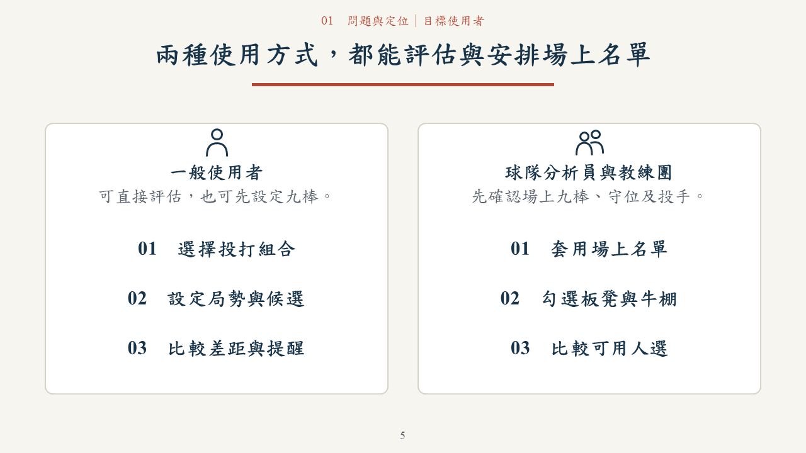
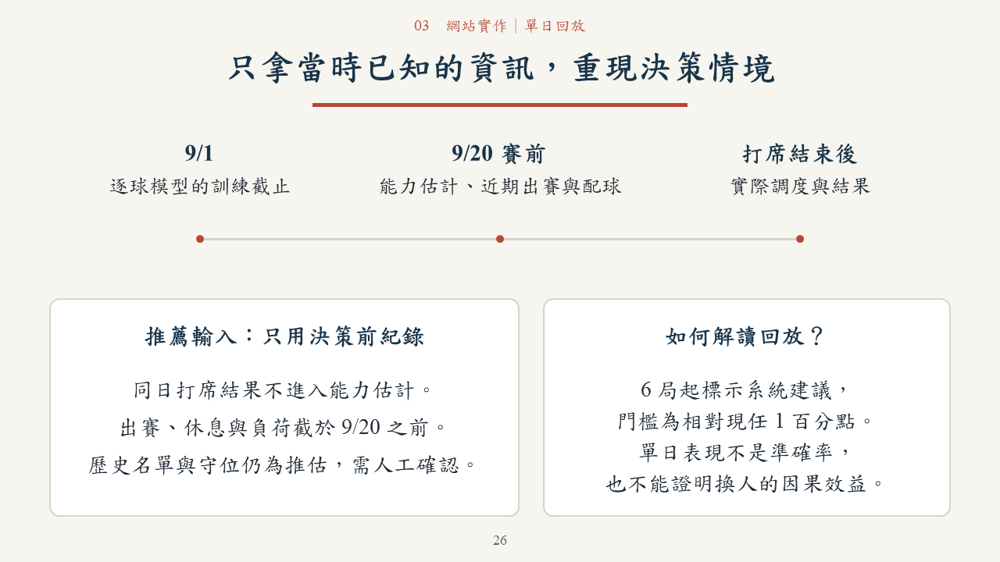

# 一球兩面｜臨場用人決策：正式參賽提案

[下載 PowerPoint（38 頁，含操作影片）](一球兩面_正式參賽提案_38頁_20261019.pptx) · [閱讀 PDF](一球兩面_正式參賽提案_38頁_20261019.pdf)

隊名：一球兩面。參賽者：蘇櫟、陳信安。

供初審評審獨立閱讀。保留淺色棒球記分卡配色，以同一套置中版面、字級與標題底線統一所有頁面；中文採標楷體，英文與數字採 Times New Roman。四張換章頁依序說明問題、資料方法、網站實作、成果與開發規劃。成果指網站功能，簡報與錄影是展示材料。

網站：https://da-xiong-chen.github.io/baseball_project/

原始碼：https://github.com/Da-Xiong-Chen/baseball_project

封面與結語直接印出上述完整網址，並保留超連結。

## 六項初審要求對照

| 要求 | 頁面 |
|---|---|
| 希望解決的棒球問題 | 4、6、7 |
| 目標使用者與使用情境 | 5、8、15–16 |
| 預計使用的資料 | 10、26 |
| 分析方法 | 11–13、26、37 |
| 產品構想與實作 | 15–31 |
| 預期成果與開發規劃 | 33–36 |

## 網站案例與 Demo

- 代打：統一對富邦，8 局上 1：2、一出局二壘有人；魔力藍對林佳緯（DH），比較胡金龍、陳鏞基、楊竣翔。胡金龍相對現任 +1.05 百分點，仍需確認接守及可用名單。
- 換投：樂天防守，魔神龍已投 95 球，固定接下來三棒；朱承洋在已選後援中 +2.51 百分點。未模擬後續局數或整場調度。
- 配球：魔力藍面對右打，2025/09/20 賽前兩期 428／258 球；低落類 18% → 34%、速球類 53% → 41%。低落為球種分類，不代表落點或效果提升。
- 單日回放：六隊三場共 226 打席，全部可切換代打與換投；19 次實際換投另外保留原投手續投基準。能力估計截至 9/20 賽前，逐球模型截至 9/1。
- 真實打席：2025-341-a026，郭永維相對林家鋐 +0.54 百分點，未達 1 百分點門檻；實際對魔力藍代打為一壘安打。單次結果不能判定調度優劣。

第三章第 31 頁內嵌 25.2 秒實際網站操作影片，桌面 PowerPoint 放映時點影片即可播放，無需另下載 MP4。PDF 保留結果停格，其餘案例與方法可直接閱讀，不依賴播放影片或旁白。

全季研究資料有 11,962 個時機標記，其中換投有效比較 11,868 個。區間圖的 +0.043（95% 區間 +0.017～+0.068）是續投者的組間 RE24 差，為觀察性比較，不能推論換人的因果效益。代打組間差異尚不明顯。單日示範與全季研究分開說明。

## 下一步規劃

- **2026 跨年度資料接入（第 34 頁）**：在取得可用資料並確認授權後，補齊新球員、轉隊、背號、正式名單、逐場守位與逐球／投球負荷紀錄。
- **賽季中動態更新（第 35 頁）**：每場後更新近況；驗證近幾場視窗與時間衰減權重，樣本少時降低近期影響、保留長期基準。只以過去資料驗證後續比賽，有改善才採用。
- **實務功能（第 36 頁）**：單場名單與退場管理、換投候選負荷對照、逐場守位與名單回放，分別列出驗收條件。

以上是開發方向，未宣稱已接入 2026 或完成新的權重校準。

## 交付驗證

38 頁容量與原生匯出檢查通過。已用 PowerPoint 原生輸出全部 PNG／PDF 並反覆檢查，451 個文字物件字型及段落置中符合設定，沒有文字超出投影片；內嵌影片與原錄影位元組一致，完整解碼及原生重開通過。原頁數值、完整網址與三個 DOI 連結保留。

[本輪修改與驗證](REVISION-20261019-STYLE.md) · [機器驗證紀錄](驗證紀錄_38頁.json) · [既有網站測試](../../docs/qa/day-release-20261019/README.md)

舊 22 頁與 34 頁檔案保留供歷程追溯，請以本頁上方連結的 38 頁版本為正式閱讀版。22 頁歷程見 [舊版紀錄](ARCHIVE-22-SLIDES.md)。
