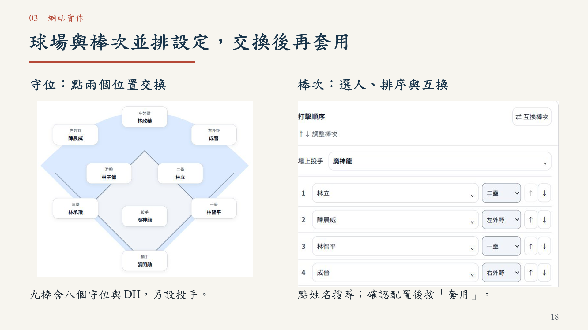
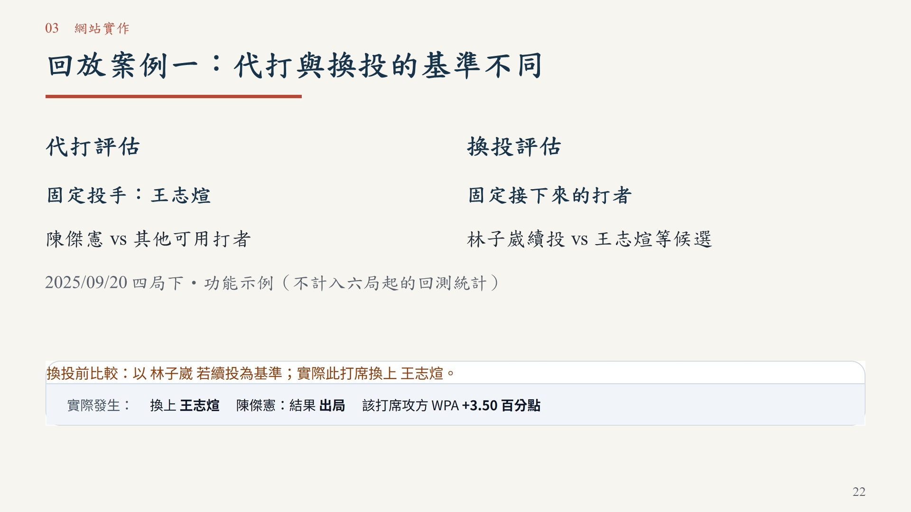

# 一球兩面｜臨場用人決策：正式競賽提案

[下載 PowerPoint（32 頁，含影片）](一球兩面_正式競賽版_32頁_評審精簡版_20261020.pptx) · [閱讀 PDF](一球兩面_正式競賽版_32頁_評審精簡版_20261020.pdf)

隊名：一球兩面。參賽者：蘇櫟、陳信安。供初審評審獨立閱讀，成果指網站功能。

網站：https://da-xiong-chen.github.io/baseball_project/

原始碼：https://github.com/Da-Xiong-Chen/baseball_project

## 最新32頁版

將比較條件併入應用創新；場上守位與棒次放在同頁；提醒併回實際代打／換投示例；移除重複成果回顧。四章、研究與驗證界線、三項具體後續規劃和第三章第26頁25.2秒Demo均保留。字體、配色與原36頁版一致。

新11頁釐清勝率換算差距與實測效益的差別；新22頁以較清晰網站摘要說明回放攻守基準，並註明四局下功能示例不計入六局起統計。保留網站／原始碼完整網址，PDF不靠影片也能閱讀。

## 初審要求對應

| 要求 | 頁面 |
|---|---|
| 希望解決的棒球問題 | 4、6 |
| 目標使用者與使用情境 | 5、7、16–17 |
| 預計使用的資料 | 9、23、28 |
| 分析方法 | 10–14、23、31 |
| 產品構想與實際Demo | 7、16–26 |
| 預期成果與開發規劃 | 已有成果12–26；下一步28–30 |

工程452組是重算對照，226打席是回放涵蓋量，不作準確率。全季觀察性RE24結果保留樣本去向、單位及常態近似區間，未依比賽群聚校正，不作因果解釋。1百分點是提示設定；2026、近期權重與新增實務功能仍為規劃。

## 驗收

32頁容量與原生結構檢查通過；PowerPoint原生輸出及另存重開通過，336個文字物件無超出畫布；指定字型核對通過。26頁僅改頁碼，正文與原版逐像素一致。PDF32頁可搜尋；影片位元組保留且完整解碼。標楷體未宣稱內嵌，附PDF。

詳見 [修訂與驗收](REVISION-20261020-COMPACT.md)、[機器可讀驗證紀錄](評審精簡版驗證紀錄_32頁.json)。本輪僅更新投影片，沒有修改網站、資料或評分。

36、40、38頁版保留供追溯，本次以本頁連結的32頁版為準。
