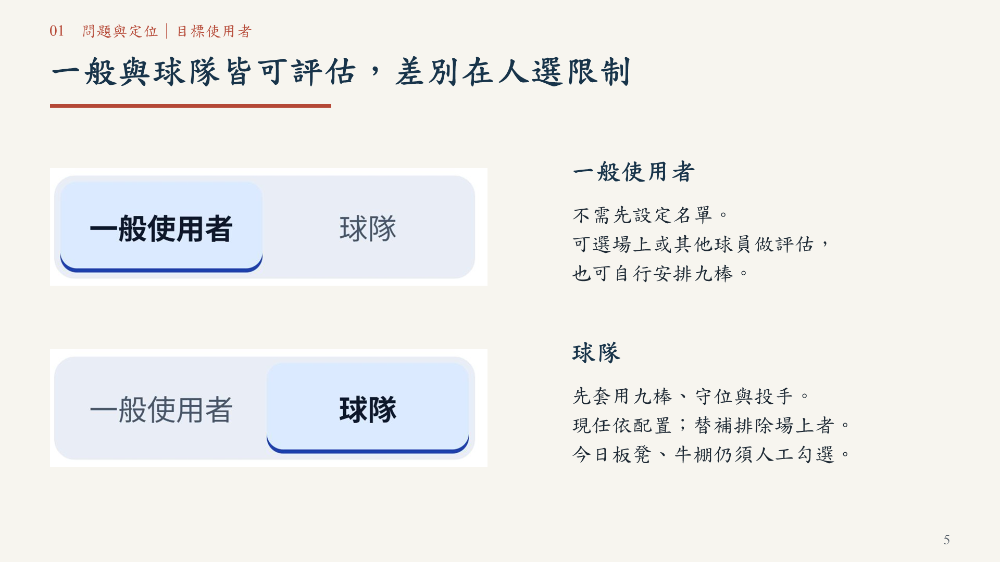
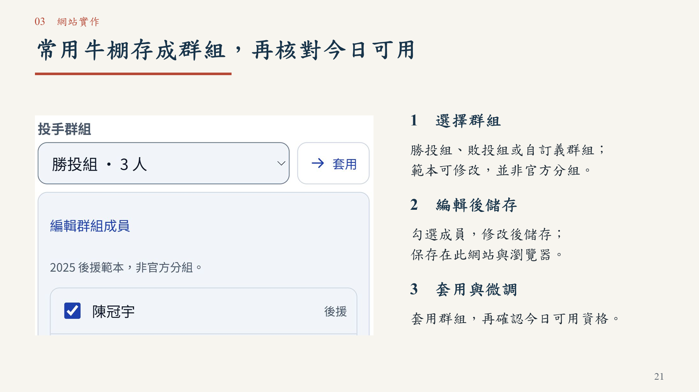

# 一球兩面｜臨場用人決策：正式競賽提案

[下載 PowerPoint（36 頁，含影片）](一球兩面_正式競賽版_36頁_清晰精簡版_20261020.pptx) · [閱讀 PDF](一球兩面_正式競賽版_36頁_清晰精簡版_20261020.pdf)

隊名：一球兩面。參賽者：蘇櫟、陳信安。供初審評審獨立閱讀，成果指網站功能。

網站：https://da-xiong-chen.github.io/baseball_project/

原始碼：https://github.com/Da-Xiong-Chen/baseball_project

## 本次交付

原第 5、8、23 頁改用網站原始控制項高倍率重新繪製的清晰截圖，群組頁現為第 21 頁。新圖在 1920×1080 展示尺寸均有足夠來源像素；不是放大舊圖或 AI 補畫。選單按鈕分別擷取後於 PPT 依原順序並排。

四頁重複資訊整合，40 頁精簡為 36 頁。模式限制併入第 5 頁，代打條件併入第 17 頁，配球樣本與網站圖表併入第 22 頁，重複的操作流程摘要刪除。保留四章、中文標楷體／英數 Times New Roman、第三章第 29 頁 25.2 秒 Demo，以及完整網址。PDF 可獨立閱讀，無須播放影片。

## 初審要求

| 要求 | 頁面 |
|---|---|
| 棒球問題 | 4、6–7 |
| 使用者與情境 | 5、8、17–18 |
| 使用資料 | 10、25、32 |
| 分析方法 | 11–15、25、35 |
| 產品構想 | 6–8、17–29 |
| 成果與開發規劃 | 31–34 |

工程對照、現行模型預測效能與實務成效分開；226 是回放涵蓋量，452 組是既有工程對照，不作準確率。全季觀察性 RE24 結果保留樣本去向、單位及常態近似區間，未依比賽群聚校正，不作因果解釋。1 百分點是提示設定。2026、近期權重與新增實務功能仍為規劃。

## 驗收

36 頁容量檢查通過；PowerPoint 原生全頁輸出及另存重開，384 個文字物件無超出頁面，指定字型核對通過；三處截圖另以 1080p 檢視。PDF 36 頁可搜尋；影片位元組保留、完整解碼，未另做滑鼠點播。標楷體未宣稱內嵌，附 PDF。

詳見 [修訂與驗收](REVISION-20261020-CRISP.md)、[機器可讀紀錄](清晰精簡版驗證紀錄_36頁.json)。網站既有驗收見 [單日驗收](../../docs/qa/day-release-20261019/README.md)，本輪沒有修改或重測網站模型。

40 頁及更早版本保留供追溯，本次以本頁連結的 36 頁版為準。
